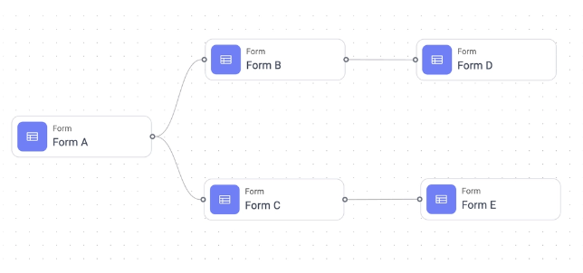
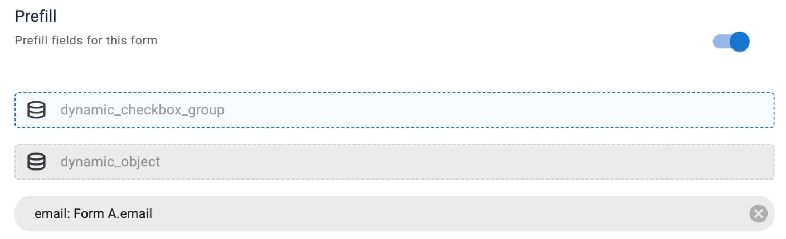
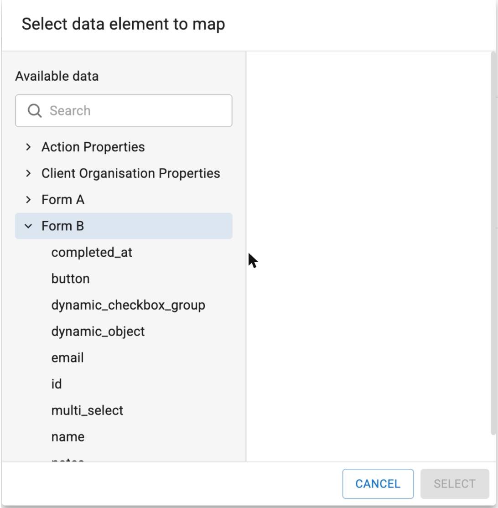

# 01 · The brief, the reference UI, and the real API vs the mock

**Date:** Tue 13 Oct 2026
**Inputs:** the [challenge page](https://www.notion.so/Journey-Builder-React-Coding-Challenge-190d5fe264fa80cba39ec21afc6d42ec) and the three pages it links to: [DAG](https://en.wikipedia.org/wiki/Directed_acyclic_graph), the [`action-blueprint-graph-get` docs](https://admin-ui.dev-sandbox.workload.avantos-ai.net/docs#/operations/action-blueprint-graph-get), and the [mock server](https://github.com/mosaic-avantos/frontendchallengeserver).
**Deadline:** four business days from Mon 12 Oct (evening) → Fri 16 Oct 2026.

This document is the reading phase: what is asked, what the screenshots actually show, and where the real API differs from the mock. No code yet.

---

## 1. What is asked

Avantos has a node-based UI showing a DAG of forms. When a form is submitted, its values can **prefill** fields of forms further down the graph. The challenge rebuilds a small part of it:

1. Call `action-blueprint-graph-get` on the mock server and **render a list of forms**.
2. Build the **prefill UI** for a form: view and edit the mapping from each of its fields to a data element.
   - A mapped field reads `email: Form A.email` with an **×** that clears it.
   - An unmapped field opens the modal **"Select data element to map"**.
3. The modal offers three kinds of data for Form D:
   1. fields of forms D **directly** depends on → Form B
   2. fields of forms D **transitively** depends on → Form A
   3. **global data** (Action Properties, Client Organisation Properties; "use whatever global data you want")

### The bold parts

| #   | Bold in the brief                                                                                                    | Reading                                                                                    |
| --- | -------------------------------------------------------------------------------------------------------------------- | ------------------------------------------------------------------------------------------ |
| B1  | "You do not need to render the forms as a node-based UI as in the above screenshot."                                 | A list is enough.                                                                          |
| B2  | "It doesn't need to be pretty, but this UI will need to view and edit the prefill mapping."                          | Behaviour over looks; the flow must be complete.                                           |
| B3  | "You should design your code so that any combination of these data sources can be easily used without code changes." | **The core requirement.** Which sources are active is configuration. New sources are easy. |
| B4  | "Does the project have good tests?"                                                                                  | Tests are scored explicitly.                                                               |
| B5  | "How do I extend with new data sources?"                                                                             | The docs must teach it, with a real example.                                               |

The non-bold sentence after B3 matters as much: _"you should design for easy support of future, new data sources."_

### Rules and criteria

- Submission: a GitHub repo link. AI use is encouraged, "but you should understand and own your code. **We will be building on it in the live portion.**"
- Criteria: (1) code organisation: separation of concerns, component hierarchy and composition; (2) extensibility: **tests**, reusable and composable components; (3) documentation: how to run locally, **how to add data sources**; (4) code quality: clean code, readable names, modern React.
- A Claude-generated starter is offered as optional. **This project does not use it.** The live session builds on this code, so every line should be one I chose; the starter is only used as a second opinion on scope.

---

## 2. What the screenshots show

The page has three images. Each one contains details the text does not mention.

### 2.1 The DAG

`A → B → D` and `A → C → E`. Edges point from prerequisite to dependant. Direct dependency = one edge; transitive = reachable by a path of length ≥ 2. (The mock adds a Form F that depends on both D and E, a "diamond": A is reachable from F through two paths and must be listed once.)

### 2.2 The prefill panel (Form D)

| Detail                                                                                               | Consequence                                                                                   |
| ---------------------------------------------------------------------------------------------------- | --------------------------------------------------------------------------------------------- |
| Heading "Prefill · Prefill fields for this form" with an **on/off switch**                           | Prefill is enabled per form. The panel needs a toggle, and the state needs an `enabled` flag. |
| Unmapped rows show a **database icon** and the **field key** (`dynamic_checkbox_group`), not a title | Rows are keyed by field name. The first row is focused (dashed outline).                      |
| Mapped row: `email: Form A.email` with a round **×** on the right                                    | Label format `field: Source.element`.                                                         |
| Only three fields are shown                                                                          | Cropped screenshot; the mock form has eight.                                                  |

### 2.3 The picker

| Detail                                                                                                                           | Consequence                                                                                                                                                     |
| -------------------------------------------------------------------------------------------------------------------------------- | --------------------------------------------------------------------------------------------------------------------------------------------------------------- |
| Title "Select data element to map"; **two panes**: "Available data" (search + tree) left, an empty detail pane right             | The dialog is wider than a list; the right pane shows the highlighted element.                                                                                  |
| Group order: Action Properties, Client Organisation Properties, Form A, Form B                                                   | Global data first, then forms alphabetically, direct and transitive mixed. **The order is a presentation choice**, so it should be configurable, not hardcoded. |
| Form B expanded lists **`completed_at`, `button`, dynamic_checkbox_group, dynamic_object, email, id, multi_select, name, notes** | A form offers its **fields plus submission metadata** (`completed_at` is not in `field_schema`). `button` is offered too.                                       |
| Footer: **CANCEL** and **SELECT**, SELECT disabled                                                                               | Highlight first, confirm second. Select is disabled until something is highlighted.                                                                             |

---

## 3. The real API vs the mock

The brief says "use our docs to hit our endpoint from a mock server". The two disagree in places, and the live session will likely move towards the real one.

| Topic                 | Real `action-blueprint-graph-get`                                                                                                             | Mock server (`fdfbb9c`)                                                                                               | Decision                                                                                                       |
| --------------------- | --------------------------------------------------------------------------------------------------------------------------------------------- | --------------------------------------------------------------------------------------------------------------------- | -------------------------------------------------------------------------------------------------------------- |
| Path                  | `/api/v1/{tenant_id}/actions/blueprints/{action_blueprint_id}/{blueprint_version_id}/graph`                                                   | `/api/v1/{x}/actions/blueprints/{y}/graph`; any `x`, `y`; always returns `graph.json`; `GET` only; port fixed at 3000 | Path segments are configuration; the version segment is optional (empty = mock shape).                         |
| Node identity         | `nodes[].id`, `edges[].source/target` and `data.prerequisites[]` are **component keys**                                                       | `id === data.component_key` for every node                                                                            | Use `id`; document that it is the component key.                                                               |
| Node types            | `form, branch, trigger, configuration, forEach, action, statusGate, calculator, dynamicTask`                                                  | All six nodes are `form`                                                                                              | Only `form` nodes are listed and offered as sources; other types still take part in traversal.                 |
| Nullability           | `nodes`, `edges`, `prerequisites`, `branches`, `triggers`: `array or null`                                                                    | Always arrays                                                                                                         | Parse with a schema that turns `null` into `[]`.                                                               |
| Dependencies          | Stored twice: `edges[]` and `data.prerequisites[]`                                                                                            | Both present and consistent                                                                                           | Read `prerequisites` (it is per node, what the UI needs); edges are a cross-check.                             |
| `input_mapping`       | `dictionary[string, oneOf]`: "maps the input keys to the expression that will be used to extract the value at runtime"; ~20 expression shapes | `{}` on every node                                                                                                    | The saved form of a mapping is an expression per field. Keep references typed so they can be serialised later. |
| Saving                | `action-blueprint-graph-put` exists                                                                                                           | No write endpoint                                                                                                     | State lives in memory; the reducer is the seam for a PUT later.                                                |
| Global data           | Expressions reference `action.*` and `clientOrg.*` (e.g. the calculator example `clientOrg.name + ' - ' + action.Status`)                     | Nothing                                                                                                               | Mock the two groups with plausible properties.                                                                 |
| Other sources         | `data_store_schema.keys` ("run data store keys available to mappings"), `dl_input_mapping` (data layer)                                       | Absent                                                                                                                | Future sources; the contract must not assume "forms or globals".                                               |
| Field expression hint | `dynamic_field_config.*.payload_fields.userId = { "type": "form_field", "value": "id" }`                                                      | Present in the mock                                                                                                   | A `{ type, value }` shape is the product's own vocabulary for "a form field".                                  |

### The mock data

- One blueprint, "Onboard Customer 0": 6 nodes (Form A–F), 6 edges, 3 form definitions; `branches` and `triggers` empty.
- All three forms have the same eight fields: `button, dynamic_checkbox_group, dynamic_object, email, id, multi_select, name, notes`. Form A, D, E and F share one definition; B and C each have their own.
- DAG: `A → B → D`, `A → C → E`, `(D, E) → F`.
- `graph.json` is served with `Access-Control-Allow-Origin: *`, so the browser can call it directly.

---

## 4. Facts to design against

1. **Sources are plural and open-ended:** the brief names three, the screenshot shows a fourth kind of thing (`completed_at`), the real API has at least two more. The contract must be "a source produces groups of selectable elements", nothing narrower.
2. **A mapping must be serialisable:** the product stores an expression per field; a selection should be a typed reference, not a display string.
3. **Prefill has an on/off switch per form.**
4. **Group order in the picker is presentation**, and the reference order is not "direct, transitive, global".
5. **The real schema is looser than the mock:** nullable arrays, many node types, a version segment in the path.
6. **Forms are reused:** four nodes point at one form definition, so a "source form" is a node, not a definition.
7. **Only `GET` exists in the mock**, so persistence is out of scope; the state design should not block it.
